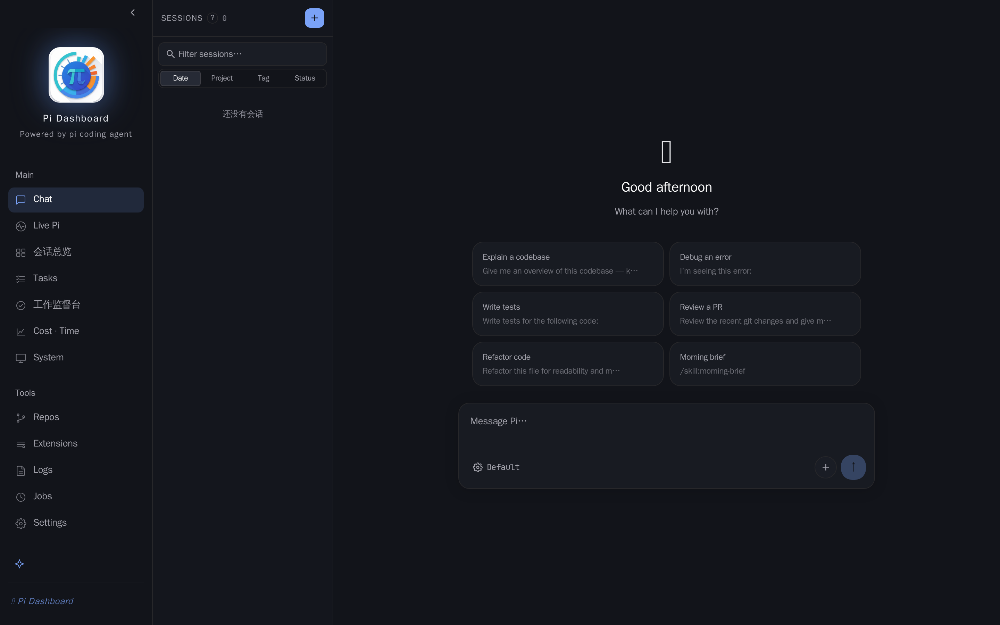
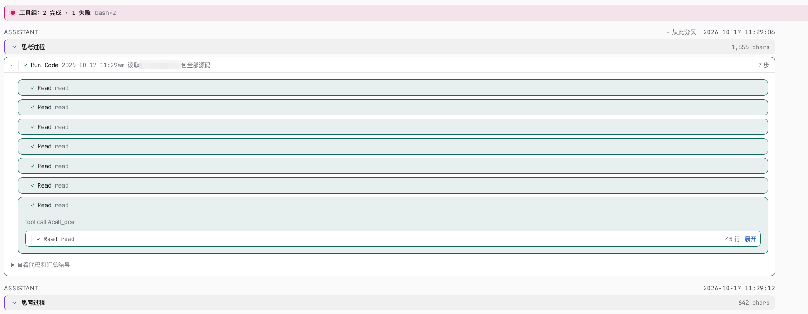
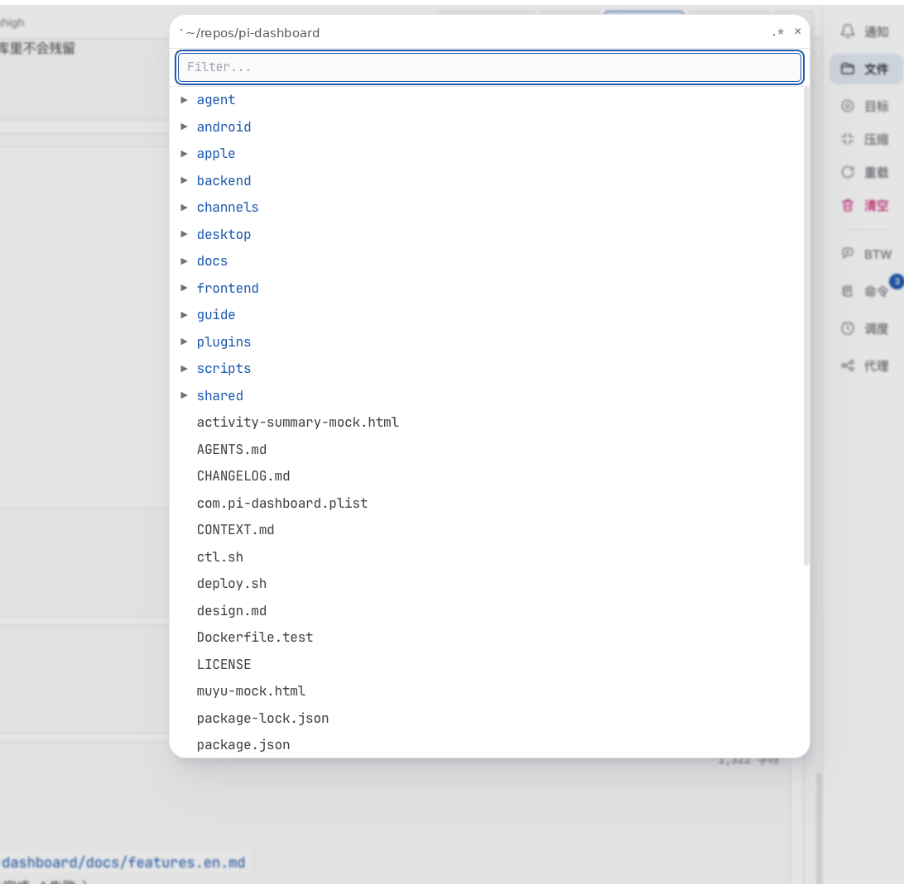
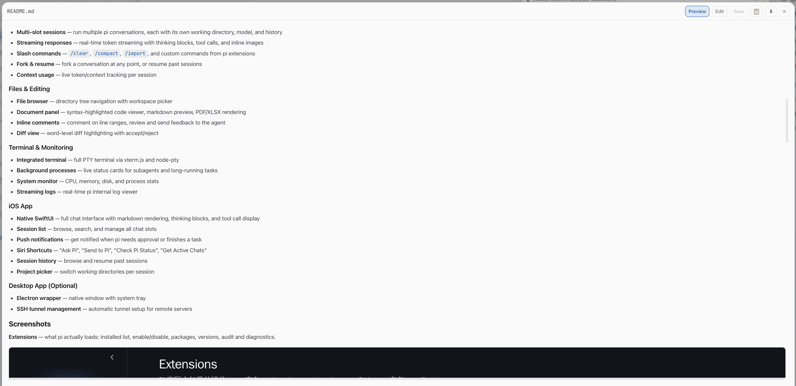
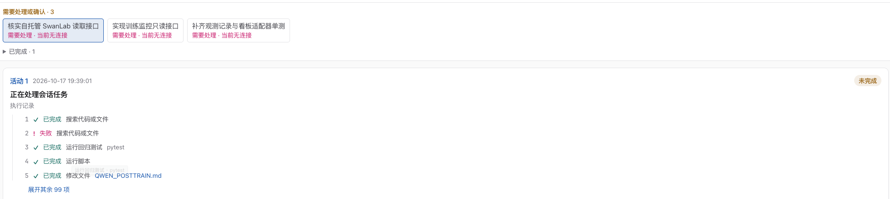
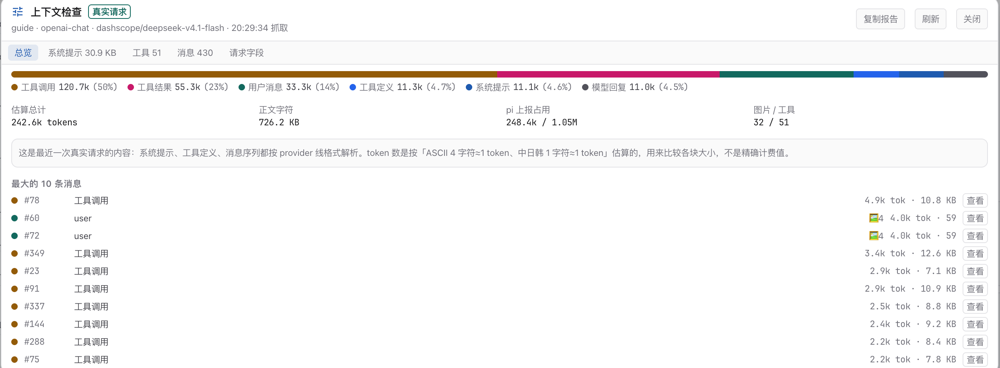
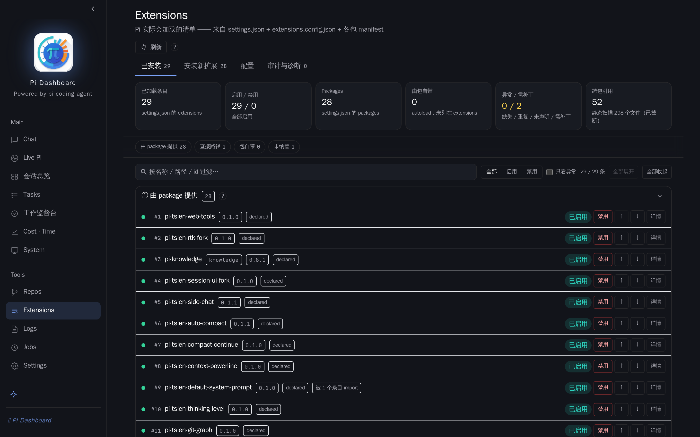
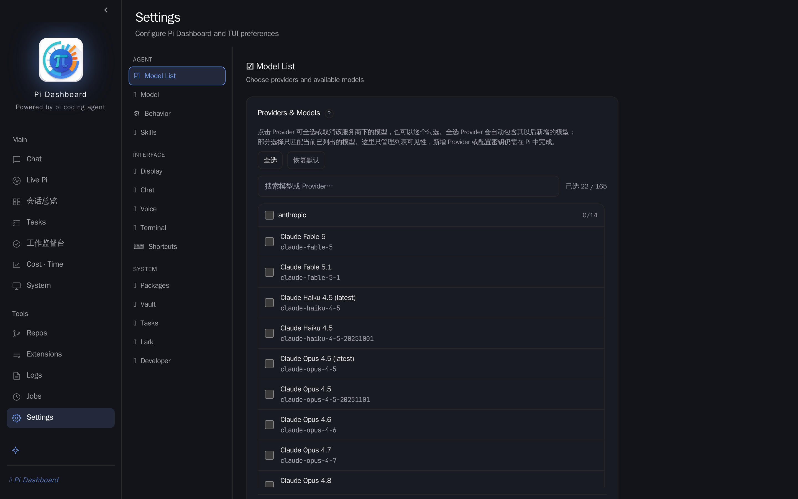

# Pi Dashboard 功能导览

[English version](features.en.md)

Pi Dashboard 是 [pi](https://github.com/mariozechner/pi-coding-agent) 编程助手的浏览器控制台。装上它之后，你和 pi 的日常从「终端里的一个对话」变成「一个可以同时开很多条线、看得见进度、留得下痕迹的工作台」：

- 在浏览器里和 pi 聊天，多条会话并行，每条有自己的工作目录、模型和历史
- 让 pi 改代码时，你可以在同一个界面里看文件、留评论、看 diff
- 同时盯着好几个正在跑的 pi 会话，随时接管
- 看成本、看耗时、看机器状态，不用另开终端
- 手机上也能用（iOS / Android），桌面端有 Electron 壳

这份文档按界面上的模块逐个介绍。想先跑起来看安装步骤，去 [README](../README.md)。

> 语言：本文是中文版。英文版见 [features.en.md](features.en.md)。

---

## 界面总览

整个界面分三块：

- **左侧导航**（固定宽度，可折叠），分两组：
  - **Main**：Chat、Live Pi、会话总览、Tasks、工作监督台、Cost · Time、System
  - **Tools**：Repos、Extensions、Logs、Jobs、Settings
- **中间主区**：当前页面。
- **右侧文件面板**：在聊天页点顶栏的「📄 Files」打开，用来浏览和编辑文件。

Chat 页是最常待的地方：左边是一列会话（可以按 Date / Project / Tag / Status 排序、搜索过滤），中间是对话区和输入框（带模型选择、附件、发送）。

---

## 聊天 Chat

核心就是和 pi 对话，但比终端里多几件事：

- **多会话**：每个会话是一个独立槽位，有自己的工作目录、模型和上下文。左侧列表管理它们。
- **流式输出**：回复是逐字出来的，思考过程、工具调用、命令输出都分块展示，图片直接内嵌。
- **工具调用可见**：pi 读了哪个文件、跑了什么命令、结果如何，都在对话里折叠展示，不用猜。
- **斜杠命令**：`/clear`、`/compact`、`/import` 等内置命令，以及扩展自己注册的命令，输入 `/` 会弹出菜单。
- **分支与续聊**：可以在任意一条消息处分叉出一个新会话继续问，也可以把过去的会话接着聊：命令面板（`⌘K` / `Ctrl+K`）里选「Resume Session…」或直接按 `Ctrl/⌘+Shift+H`，就能搜索历史会话并按标题、项目或会话正文匹配后接着聊。不需要额外建全文索引，直接读会话文件。
- **上下文用量**：会实时显示当前占用了多少 token，什么时候该 `/compact` 一目了然。
- **语音输入**：输入框支持语音（详见 Settings → Voice）。

上图是一段真实对话的一角：思考过程可以折叠；工具调用按组分块，组头上直接写着「几步、几步成功、几步失败」（例子里是「2 完成 · 1 失败」），失败的不会被藏起来。

---

## 文件和文档协作

这是 Pi Dashboard 区别于「终端里聊天」最明显的地方。点 Chat 页顶栏的 **📄 Files** 打开文件面板：

- **文件树**：按目录展开，可切换工作区，`.*` 按钮显示隐藏文件。聊天里出现的文件路径也可以直接点开。
- **两种模式**：
  - **预览**：Markdown 渲染 / 代码高亮，默认模式
  - **编辑**：直接在面板里改，Ctrl+S 保存
- **行内评论**：选中一句话（或点行号选一行、拖选一段），右键「Add Comment」留评论。评论会记下**行号区间 + 被引用的原句**，所以 pi 知道你指的是哪句。
- **Review Comments**：点评论条上的按钮，把当前所有待发评论集中在一个弹窗里，可以删掉不想要的、改措辞，然后一次性发给 pi。
- **Diff 与版本**：每次保存都会留一个版本快照，可以下拉切换版本、点 Diff 做逐词对比。
- **冲突处理**：如果你正在改文件而 pi 也改了，会弹黄色提示条，给你「Reload / Keep Mine / Show Diff」三个选择；你没未保存改动时，面板会直接跟着 pi 的编辑实时更新。

评论存在文件旁边的 `.{文件名}.comments.json` 里（已 git-ignore），所以可以直接发给 pi 读。

看图可以看到完整闭环：左边是文件树（可切工作区、可按名字过滤）；右边是全屏预览，右上角一排就是 **Preview / Edit 切换、保存、下载原文件**，阅读和修改不用离开 dashboard。图片、PDF、表格、代码也都能在同一个窗口里看。

典型用法：pi 起草一份文档 → 你打开它、对着不同意的句子留评论 → Review Comments 一次性发送 → pi 改 → 面板自动更新，你看 diff。

---

## 终端

界面里带一个完整的终端（xterm.js + node-pty），不用切窗口就能跑命令。适合「pi 让我确认一下某个结果」这类临时操作。

---

## Live Pi 实时会话

看**正在运行**的 pi 会话，并且可以接管。

- 出于安全，第一次使用要输入**本机控制 token** 认证，token 文件路径是 `~/.pi/agent/run/pi-dashboard/live-control-token`。
- **会话总览**有两个视图：**会话卡片**（一屏看多个会话在干什么）和**家族图谱**（看会话之间的父子/派生关系）。
- 子代理和后台任务的运行状态也在这里可见。

正在干活的会话，行首会有一个「敲木鱼」的小动画（锤子敲下去、木鱼被压扁、飘出「+1」），一眼就能看出哪条在忙。

---

## 子代理（Subagent）

pi 干活时会派出一批子代理并行处理小任务。这一块把它们的实时状态搬到 dashboard 上，不用去翻日志或猜：

- **按状态分组**：运行中 / 需要处理或确认 / 已完成 / 已停止。需要你拍板的排在最显眼的位置。
- **不假装在跑**：某个子代理已经不连着会话了，卡片上直接写「当前无连接」，不会显示成还在干活。
- **随时收手**：运行中的子代理旁边就有「停止」按钮（点一下变「确认停止」）。
- **一步一步看它做了什么**：下面跟一张活动卡片，写明这次活动在干什么、从几点开始，以及「执行记录」——第几步做了什么、哪一步失败，逐条列出来；步骤多的时候折叠成「展开其余 N 项」，失败的步骤不会被隐藏。

上面这张就是实际效果：三条「需要处理或确认」的子代理任务，下面一条活动的执行记录（第 2 步失败，后面的步骤照常继续），末尾还有 99 项被折叠起来。

---

## 上下文检查（context 命令）

Live 会话页顶部工具栏有个 **「◲ 上下文」** 按钮，它回答一个平时只能靠猜的问题：**这个会话到底把什么发给了模型**。

- **数据来源如实标注**：「真实请求」＝最近一次真正发给 provider 的载荷（已按 OpenAI / Anthropic / Google / Bedrock 各家线格式归一）；进程还没发出过请求时显示「近似重建」，并说明哪些东西没算进去。
- **五个页签**：总览、系统提示、工具、消息、请求字段。总览给出各类别估算 token 与占比、最大的 10 条消息；系统提示会按项目说明 / 技能清单 / 准则 / 基础提示拆开；工具按定义体积排序；消息可搜索、展开全文；请求字段看模型、推理强度这类非内容字段。
- **token 是估算**：按「ASCII 4 字符≈1 token、中日韩 1 字符≈1 token」估的，用来比较各块大小、不是计费值；旁边同时给出 pi 上报的真实占用，两者有差距是正常的。每行还带真实字符数，正文被截断也不会失真。
- **复制报告**：导出一份纯文本结论（来源、各类别占比、最大的块），不含正文，可以直接贴给别人或交回给 agent 做优化。
- 只读，不需要接管会话；别的浏览器把会话接管了也能看。

上图是一份真实报告：工具调用占了 50%（120.7k），工具结果 23%，用户消息 14%——一眼就能看出“上下文到底被什么吃掉了”。

> 小坑：这个能力由 Pi 进程启动时加载的扩展提供，所以已经在跑的老板会需要**重载**一次才能用；新开的会话天生就是新版。

---

## 工作监督台

面向「同时跑着很多任务，怎么知道哪个不对劲」的场景。原则写在界面上一句话：**基于授权任务与会话证据；未知不当作正常**。也就是说它不会把「看不到证据」当成「没问题」。

页面提供「刷新」和「询问主管」两个动作，用来拉取当前状态或直接让主管 Agent 汇总。

---

## 任务 Tasks

把工作当成任务来管：

- 顶部有统计条（活跃 / 进行中 / 待办 的数量），下面按状态筛选（活跃、进行中、待办、暂停、已完成、归档、全部），还能按来源过滤、按标题或 ID 搜索。
- 两个页签：**任务清单** 和 **事件流水**（任务状态的变更记录）。
- 「临时任务」按钮可以快速起一个不进入正式流程的任务。

---

## 成本与耗时 Cost · Time

三个页签：

- **成本**：本月费用、本月 token 用量、缓存命中率、活跃会话数；下面还有每日费用与 token 的双轴折线图。
- **耗时**：时间维度的统计。
- **模型排行榜**：按模型比较能力/成本相关的指标。

另外有一块 **Codex / Claude Code 限额**：显示本机账号的 5 小时窗口与周窗口用量（需要对应 CLI 已登录并支持查询订阅用量）。

---

## 运行监控：System / Logs / Jobs

- **System**：机器和环境的概览。顶部一排卡片是会话数、pi 进程数、技能数、扩展数等；标签页分 Overview、Host Sessions、Memory、Skills、Sessions、Vault。
- **Logs**：pi 会话的实时日志流，可以按级别过滤、开自动滚动（Auto scroll / Live）、一键清空。
- **Jobs**：定时任务。用 cron 表达式按时给 pi 发一段 prompt，每次运行会开一个新槽位，并保留运行历史。适合定期巡检、日报、监控检查。

---

## 代码仓 Repos

把常用的仓库登记进来，方便随时看。每个仓库存一个绝对路径，配置保存在 `~/.pi/dashboard.json`。

列表里每行显示分支、领先/落后、未提交和未推送的改动数，并提供 Graph（提交关系图）、Live Pi、GitHub、Fetch 等快捷动作。可以按标签过滤（如 #platform、#task、#xdoc）。

---

## 扩展 Extensions

管理 pi 实际会加载的扩展清单（来自 `settings.json` + `extensions.config.json` + 各包 manifest）：

- **已安装**：列表 + 启用/禁用开关，可以看每个扩展来自哪个包、版本、是否已声明。
- **安装新扩展**：装、更新、卸载。
- **配置**：各扩展自己的 JSON 配置（和 Settings 里是同一套面板）。
- **审计与诊断**：操作记录与回滚，以及跨包引用的静态扫描。

---

## 设置 Settings

按三组排列：

- **Agent**：Model List（选 Provider 和可用模型）、Model、Behavior、Skills
- **Interface**：Display（主题）、Chat、Voice（语音）、Terminal、Shortcuts（快捷键）
- **System**：Packages、Vault（密钥）、Tasks、Lark、Developer

---

## 手机和桌面端

- **iOS**：原生 SwiftUI 应用，支持聊天、思考块展开、工具调用详情、会话管理、审批推送通知，以及 Siri 快捷指令（「Ask Pi」「Send to Pi」「检查 Pi 状态」「获取活跃会话」）。
- **Android**：见 `android/` 目录。
- **桌面端**：可选的 Electron 壳，带系统托盘，能自动建立 SSH 隧道连远程服务器。

---

## 远程访问

- **Tailscale（推荐）**：两台机器在同一 Tailscale 网络里，直接用 Tailscale IP 打开 `http://<tailscale-ip>:7777`。
- **SSH 隧道**：`PI_DASH_HOST=your-server PI_DASH_USER=you ./pi-dash-connect.sh`。

更完整的部署方式见 [guide/](../guide/README.md)。

---

## 配图状态

有些页面（Tasks、Repos、System、Cost · Time、Live Pi、会话总览、工作监督台）在当前机器上带着内部信息，不适合直接公开，截图待补。清单和命名约定见 [features-shotlist.md](features-shotlist.md)。
